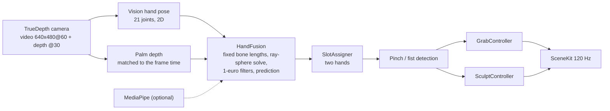

# HandGrab

[Русская версия](README.ru.md)

**Control a 3D scene with your bare hands in mid-air using the iPhone's TrueDepth camera, rendered at 120 Hz. Grab objects, or draw and sculpt in space with a pinch.**


> Status: experimental research project. **Not build-verified in this release repo** (no Xcode was available while preparing it). The code was developed and run on an iPhone Air by the author, so expect to fix small things on the first build.

## Why it is interesting

- **No controllers, no headset** - just the front Face ID camera. Apple Vision gives a 21-point 2D hand skeleton, the TrueDepth map adds depth.
- **Low latency**: 120 fps rendering, hand pose ready ~46 ms after exposure (measured on-device, see [`docs/measurements/`](docs/measurements)); the camera itself has a 33-38 ms hardware floor.
- **Two hands**, handedness handled per hand, with a slot tracker that survives noisy left/right labels.
- **Sculpt mode**: six brushes, undo, export to Photos.
- **Test without a phone**: record a session once and replay it in the Simulator, or run synthetic hands through the very same pipeline.

## Features

**Object mode** - four objects on a table; take one with a pinch or a fist (the nearest object within 10 cm is pulled into the hand), carry it, throw it. The hand is shown as a 3D arrow cursor by default; a skinned WebXR hand mesh is optional.

**Draw and sculpt mode** ([details](docs/sculpt.md)):

| Brush | Look |
|---|---|
| Plasticine | clay tube with normal map; pinch at the tip extends the line, pinch mid-stroke pulls and stretches it |
| Neon | HDR core + coloured halo, bloom |
| Silk | two-sided ribbon following the palm normal |
| Stardust | billboard particles along a thin spine |
| Chrome | metal tube in a studio cube map, sags and sets after release |
| Plasma | lightning-like filaments with branches |


## Gestures

| Gesture | Object mode | Sculpt mode |
|---|---|---|
| Pinch (thumb + index) | grab the nearest object | draw a stroke / pull a stroke (either hand) |
| Fist | grab the nearest object | one fist held >= 150 ms rotates the sculpture |
| Two fists | - | move and scale the sculpture |

## Requirements

- Mac with **Xcode** (iOS 18+ SDK) and [XcodeGen](https://github.com/yonaskolb/XcodeGen) (`brew install xcodegen`)
- An **iPhone with Face ID** (TrueDepth camera). The Simulator has no camera: it only runs replays
- An Apple Developer account (a free one is enough for your own device)

## Build and run

```bash
cp Config.example.xcconfig Config.xcconfig   # set HANDGRAB_TEAM_ID and a unique HANDGRAB_BUNDLE_ID
make open                                    # generates HandGrab.xcodeproj and opens Xcode
```

In Xcode choose your iPhone and press Run. Optional second detector (MediaPipe, used only for cross-checks and the benchmark): `make fetch-mediapipe`.

Without a phone: `make replay` builds for the Simulator and replays a synthetic hand (`scripts/sim-replay.sh`); `scripts/sculpt-sim.sh demo all 160` renders every brush.
Other launch arguments: `-replay <synth|s-DATE.jsonl>`, `-sculptdemo <all|art|pull|rotate|brush>`, `-trackeval`, `-bench`.

## How it works



1. `Capture/` - separate video and depth outputs (a synchroniser would wait for the 30 Hz depth and halve the frame rate), format selection, device probe.
2. `Tracking/` - detectors, palm-depth sampling, per-joint camera rays with fixed bone lengths, filtering, hand slots, pinch/fist state, session recorder/replayer.
3. `Scene/` and `Sculpt/` - gesture-driven interaction, stroke meshing, brushes and materials, studio lighting.

Measurements and methodology: [`docs/measurements/`](docs/measurements) (the depth stream is capped at 30 fps on the tested device).

## License

MIT, see [LICENSE](LICENSE). Third-party components: [THIRD_PARTY_NOTICES.md](THIRD_PARTY_NOTICES.md).
