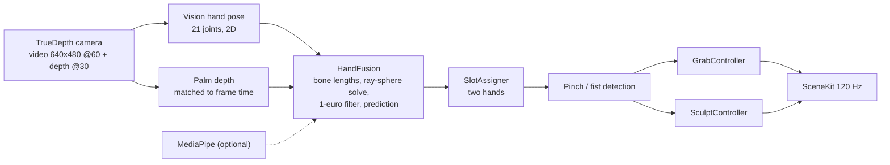

<p align="center">
  
</p>

<h1 align="center">HandGrab</h1>

<p align="center"><b>Your iPhone sees your hands in mid-air. Grab, rotate and sculpt 3D objects - no touch, no controllers, no headset.</b><br>
TrueDepth camera, Apple Vision, 120 Hz SceneKit rendering.</p>

<p align="center">
  
  
  
  
  
</p>

<p align="center">
  <a href="#-quick-start">Quick start</a> ·
  <a href="#-features">Features</a> ·
  <a href="#-gestures">Gestures</a> ·
  <a href="#-how-it-works">How it works</a> ·
  <a href="README.ru.md">Русский</a>
</p>

---

<table>
  <tr>
    <td align="center" width="33%"><br><sub><b>Object mode</b><br>pinch or fist pulls the nearest object into your hand</sub></td>
    <td align="center" width="33%"><br><sub><b>Sculpt mode</b><br>six brushes, colours, undo, export</sub></td>
    <td align="center" width="33%"><br><sub><b>Brushes</b><br>clay, neon, silk, stardust, chrome, plasma</sub></td>
  </tr>
</table>

> [!NOTE]
> Requires a **physical iPhone with Face ID** (TrueDepth camera). The Simulator supports replay mode only (recorded or synthetic hands through the same pipeline). Developed and tested on an iPhone Air; other Face ID models are untested.

## 💡 Why

Hand tracking on a phone usually means a flat 2D skeleton from the back camera. HandGrab uses the front Face ID camera: Vision gives 21 hand joints, the TrueDepth map adds real depth, and the two are fused into a 3D hand with fixed bone lengths. The result is low latency (hand pose ready about **46 ms** after exposure, measured on-device) and enough precision to actually draw in the air.

## ✨ Features

| | |
|---|---|
| 🖐 | **Grab and throw** four objects on a table with a pinch or a fist |
| 🎨 | **Draw and sculpt** in space with six brushes: clay, neon, silk, stardust, chrome, plasma |
| 🤲 | **Two hands**, independent: draw with both, rotate with one fist, scale with two |
| ⚡ | **120 fps** rendering, hand pose ~46 ms after exposure (camera floor 33-38 ms) |
| ↩️ | **Undo / redo**, smoothing, X-mirror, export to Photos, USDZ and `.hgsculpt` |
| 🧪 | **Test without a phone**: record a session, replay it in the Simulator, or run synthetic hands |

Brush details: [`docs/sculpt.md`](docs/sculpt.md) (in Russian).

## 👋 Gestures

| Gesture | Object mode | Sculpt mode |
|---|---|---|
| **Pinch** (thumb + index) | grab the nearest object | draw a stroke; pinch near a stroke tip to extend it, mid-stroke to pull and stretch it |
| **Fist** | grab the nearest object | hold one fist for 150 ms to rotate the sculpture |
| **Two fists** | - | move, scale and turn the sculpture |

The grab "magnet" radius is 10 cm by default (adjustable 2-20 cm in the calibration screen).

## 🚀 Quick start

```bash
brew install xcodegen
cp Config.example.xcconfig Config.xcconfig   # set HANDGRAB_TEAM_ID and a unique HANDGRAB_BUNDLE_ID
make open                                    # generates HandGrab.xcodeproj and opens Xcode
```

Pick your iPhone in Xcode and press Run.

| Requirement | Notes |
|---|---|
| Mac with Xcode | iOS 18+ SDK |
| [XcodeGen](https://github.com/yonaskolb/XcodeGen) | `brew install xcodegen` |
| iPhone with Face ID | needed for live tracking |
| Apple ID | a free account is enough for your own device |

<details>
<summary><b>No phone? Simulator and other commands</b></summary>

```bash
make replay                        # build for Simulator, replay a synthetic hand (scripts/sim-replay.sh)
scripts/sculpt-sim.sh demo all 160 # render every brush without tracking
make fetch-mediapipe               # optional second detector, used for cross-checks and the benchmark
```

Launch arguments: `-replay <synth|s-DATE.jsonl>`, `-sculptdemo <all|art|pull|rotate|brush>`, `-trackeval`, `-bench`.

</details>

## 🔧 How it works



1. **`Capture/`** - separate video and depth outputs (a synchroniser would wait for the 30 Hz depth and halve the frame rate), format selection, device probe.
2. **`Tracking/`** - detectors, palm-depth sampling, per-joint camera rays with fixed bone lengths, filtering, hand slots, pinch/fist state, session recorder/replayer.
3. **`Scene/`, `Sculpt/`** - gesture-driven interaction, stroke meshing, brushes and materials, studio lighting.

Measurements and methodology: [`docs/measurements/`](docs/measurements) (the depth stream is capped at 30 fps on the tested device).

## ⚠️ Limitations

- Experimental research project; the UI is in Russian.
- Live tracking is tested on one device (iPhone Air). Not yet tested on other Face ID iPhones or iPads.

## 🤝 Contributing

Issues and PRs are welcome. Keep changes small and describe how you tested them (device or replay).

## 📄 License

MIT, see [LICENSE](LICENSE). Third-party components: [THIRD_PARTY_NOTICES.md](THIRD_PARTY_NOTICES.md).

Made by [@meshoklv](https://github.com/meshoklv)
