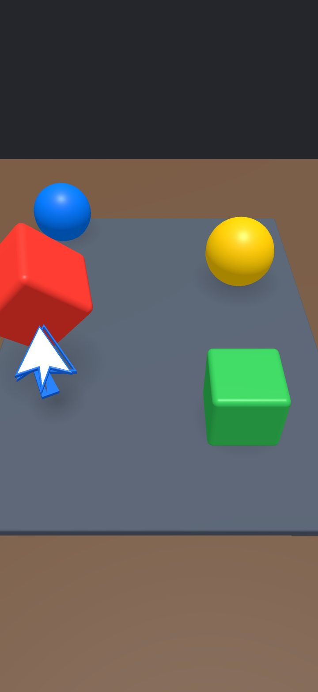
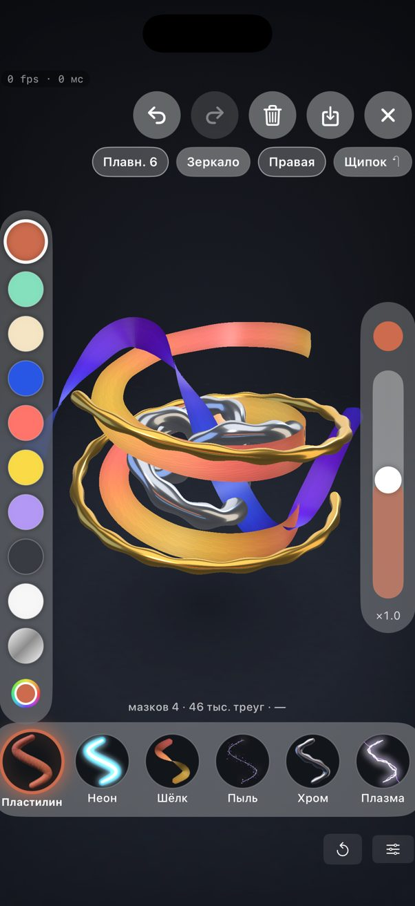
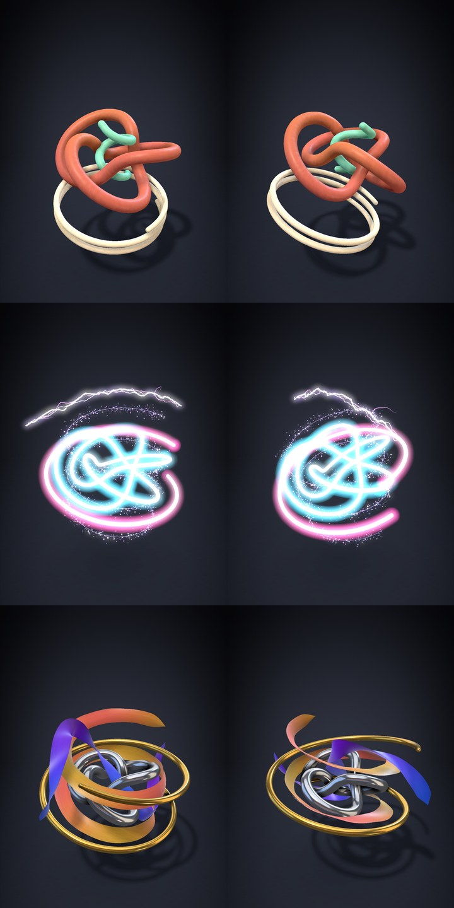
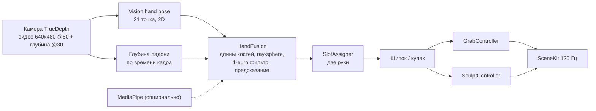

<p align="center">
  
</p>

<h1 align="center">HandGrab</h1>

<p align="center"><b>iPhone видит ваши руки в воздухе. Хватайте, вращайте и лепите 3D-объекты - без касаний, контроллеров и шлема.</b><br>
Камера TrueDepth, Apple Vision, рендер SceneKit на 120 Гц.</p>

<p align="center">
  
  
  
  
  
</p>

<p align="center">
  <a href="#-быстрый-старт">Быстрый старт</a> ·
  <a href="#-возможности">Возможности</a> ·
  <a href="#-жесты">Жесты</a> ·
  <a href="#-как-это-устроено">Как устроено</a> ·
  <a href="README.md">English</a>
</p>

---

<table>
  <tr>
    <td align="center" width="33%"><br><sub><b>Объекты</b><br>щипок или кулак притягивает ближайший предмет в руку</sub></td>
    <td align="center" width="33%"><br><sub><b>Скульпт</b><br>шесть кистей, цвета, отмена, экспорт</sub></td>
    <td align="center" width="33%"><br><sub><b>Кисти</b><br>пластилин, неон, шёлк, пыль, хром, плазма</sub></td>
  </tr>
</table>

> [!NOTE]
> Нужен **физический iPhone с Face ID** (камера TrueDepth). В Симуляторе работает только режим реплея (записанные или синтетические руки через тот же конвейер). Разработано и проверено на iPhone Air; другие модели с Face ID не проверялись.

## 💡 Зачем

Трекинг рук на телефоне обычно даёт плоский 2D-скелет с задней камеры. HandGrab берёт фронтальную камеру Face ID: Vision отдаёт 21 точку руки, карта глубины TrueDepth добавляет настоящую глубину, а вместе они собираются в 3D-руку с фиксированной длиной костей. Итог - низкая задержка (поза руки готова через **~46 мс** после съёмки, замер на устройстве) и точность, достаточная, чтобы рисовать в воздухе.

## ✨ Возможности

| | |
|---|---|
| 🖐 | **Хватайте и бросайте** четыре предмета на столе щипком или кулаком |
| 🎨 | **Рисуйте и лепите** в пространстве шестью кистями: пластилин, неон, шёлк, пыль, хром, плазма |
| 🤲 | **Две руки** независимо: рисуют обе, один кулак вращает, два - масштабируют |
| ⚡ | Рендер **120 fps**, поза руки через ~46 мс после съёмки (аппаратный минимум камеры 33-38 мс) |
| ↩️ | **Отмена и возврат**, сглаживание, зеркало по X, экспорт в «Фото», USDZ и `.hgsculpt` |
| 🧪 | **Тест без телефона**: запишите сессию, проиграйте в Симуляторе или запустите синтетические руки |

Подробно о кистях: [`docs/sculpt.md`](docs/sculpt.md).

## 👋 Жесты

| Жест | Режим объектов | Режим скульпта |
|---|---|---|
| **Щипок** (большой + указательный) | взять ближайший объект | рисовать мазок; щипок у кончика мазка продолжает его, за середину - тянет и растягивает |
| **Кулак** | взять ближайший объект | удержать одну руку в кулаке 150 мс - вращать скульптуру |
| **Два кулака** | - | двигать, масштабировать и поворачивать скульптуру |

Радиус «магнита» захвата по умолчанию 10 см (настраивается от 2 до 20 см на экране калибровки).

## 🚀 Быстрый старт

```bash
brew install xcodegen
cp Config.example.xcconfig Config.xcconfig   # укажите HANDGRAB_TEAM_ID и уникальный HANDGRAB_BUNDLE_ID
make open                                    # сгенерирует HandGrab.xcodeproj и откроет Xcode
```

Выберите свой iPhone в Xcode и нажмите Run.

| Требование | Примечание |
|---|---|
| Mac с Xcode | SDK iOS 18+ |
| [XcodeGen](https://github.com/yonaskolb/XcodeGen) | `brew install xcodegen` |
| iPhone с Face ID | для живого трекинга |
| Apple ID | для своего устройства хватит бесплатного аккаунта |

<details>
<summary><b>Нет телефона? Симулятор и другие команды</b></summary>

```bash
make replay                        # сборка для Симулятора, реплей синтетической руки (scripts/sim-replay.sh)
scripts/sculpt-sim.sh demo all 160 # отрисовать все кисти без трекинга
make fetch-mediapipe               # необязательный второй детектор: сверка и бенчмарк
```

Аргументы запуска: `-replay <synth|s-DATE.jsonl>`, `-sculptdemo <all|art|pull|rotate|brush>`, `-trackeval`, `-bench`.

</details>

## 🔧 Как это устроено



1. **`Capture/`** - отдельные выходы видео и глубины (синхронизатор ждал бы 30 Гц глубины и вдвое резал бы частоту кадров), выбор формата, проба устройства.
2. **`Tracking/`** - детекторы, выборка глубины ладони, лучи камеры по суставам с фиксированной длиной костей, фильтры, слоты рук, состояние щипка и кулака, запись и проигрыватель сессий.
3. **`Scene/`, `Sculpt/`** - интерактив по жестам, построение мазков, кисти и материалы, студийный свет.

Замеры и методика: [`docs/measurements/`](docs/measurements) (поток глубины на проверенном устройстве ограничен 30 fps).

## ⚠️ Ограничения

- Экспериментальный исследовательский проект; интерфейс на русском.
- Живой трекинг проверен на одном устройстве (iPhone Air). Другие iPhone с Face ID и iPad не проверялись.

## 🤝 Участие

Issues и PR приветствуются. Делайте небольшие изменения и описывайте, как проверили (устройство или реплей).

## 📄 Лицензия

MIT, см. [LICENSE](LICENSE). Сторонние компоненты: [THIRD_PARTY_NOTICES.md](THIRD_PARTY_NOTICES.md).

Автор: [@meshoklv](https://github.com/meshoklv)
