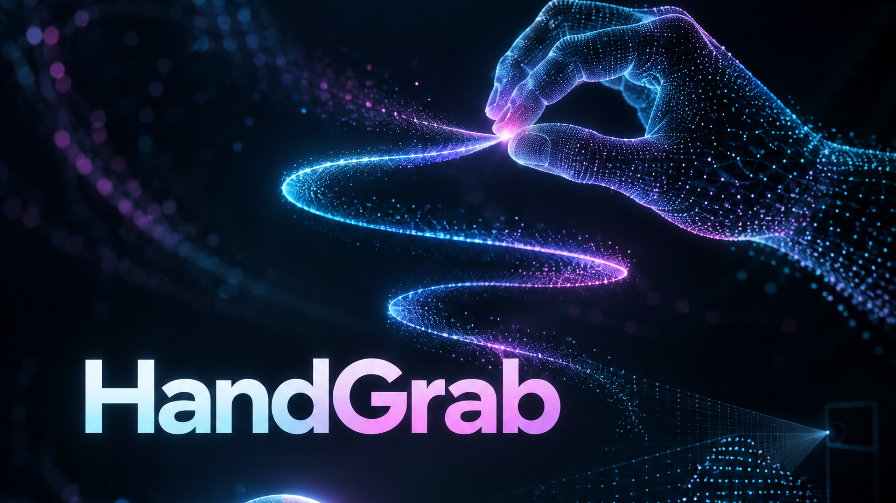
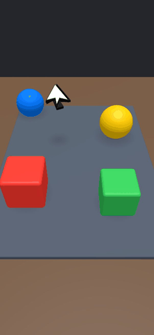
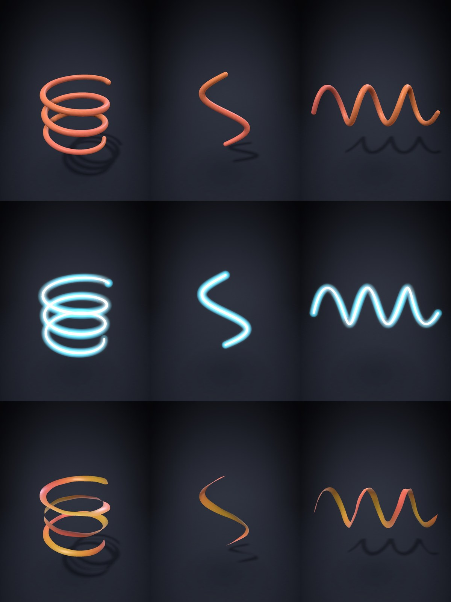

# HandGrab

[English version](README.md)

**Управление 3D-сценой голыми руками в воздухе через TrueDepth-камеру iPhone, рендер 120 Гц. Берите предметы или рисуйте и лепите в пространстве щипком.**





> Статус: экспериментальный исследовательский проект. **В этом репо сборкой не проверено** (Xcode при подготовке не было); код разрабатывался и запускался автором на iPhone Air. При первой сборке возможны мелкие правки.

## Чем интересно

- **Без контроллеров и шлема** - только фронтальная камера Face ID. Vision даёт 2D-скелет руки (21 точка), карта глубины TrueDepth - Z.
- **Низкая задержка**: рендер 120 fps, поза руки готова через ~46 мс после съёмки (замер на устройстве, [`docs/measurements/`](docs/measurements)); у самой камеры аппаратный минимум 33-38 мс.
- **Две руки**, левая/правая считаются по каждой руке, слот-трекер переживает шумные метки.
- **Режим скульпта**: шесть кистей, отмена, экспорт в «Фото».
- **Тест без телефона**: запишите сессию и проиграйте в Симуляторе или прогоните синтетические руки через тот же конвейер.

## Возможности

**Режим объектов** - четыре предмета на столе; щипок или кулак берёт ближайший в радиусе 10 см, можно переносить и бросать. Рука показывается 3D-стрелкой; скиннированная WebXR-кисть - опционально.

**Рисование и скульпт** ([подробности](docs/sculpt.md)): пластилин (тяга и растяжение), неон, шёлк, пыль, хром, плазма.



## Жесты

| Жест | Объекты | Скульпт |
|---|---|---|
| Щипок (большой + указательный) | взять ближайший объект | мазок / тяга линии (любая рука) |
| Кулак | взять ближайший объект | одна рука >= 150 мс - поворот скульптуры |
| Два кулака | - | перенос и масштаб |

## Требования

- Mac с **Xcode** (SDK iOS 18+) и [XcodeGen](https://github.com/yonaskolb/XcodeGen) (`brew install xcodegen`)
- **iPhone с Face ID** (камера TrueDepth); в Симуляторе камеры нет - там только реплеи
- Аккаунт Apple Developer (для своего устройства хватает бесплатного)

## Сборка и запуск

```bash
cp Config.example.xcconfig Config.xcconfig   # впишите HANDGRAB_TEAM_ID и свой HANDGRAB_BUNDLE_ID
make open                                    # сгенерирует HandGrab.xcodeproj и откроет Xcode
```

В Xcode выберите iPhone и нажмите Run. Второй распознаватель (MediaPipe, нужен только для сверки и бенча): `make fetch-mediapipe`.
Без телефона: `make replay` - сборка для Симулятора и реплей синтетической руки; `scripts/sculpt-sim.sh demo all 160` - все кисти.
Аргументы запуска: `-replay <synth|s-ДАТА.jsonl>`, `-sculptdemo <all|art|pull|rotate|кисть>`, `-trackeval`, `-bench`.

## Как устроено

Конвейер: **TrueDepth (видео 640x480@60 + глубина @30) → Vision, 21 точка → глубина ладони по времени кадра → HandFusion (фиксированные длины костей, пересечение луча со сферой, фильтры 1€, прогноз) → слоты двух рук → щипок/кулак → GrabController / SculptController → SceneKit 120 Гц.**
Диаграмма - в [английском README](README.md#how-it-works). Каталоги: `Capture/` (камера), `Tracking/` (трекинг), `Scene/` и `Sculpt/` (взаимодействие и кисти). Замеры - [`docs/measurements/`](docs/measurements).

## Лицензия

MIT, см. [LICENSE](LICENSE). Сторонние компоненты - [THIRD_PARTY_NOTICES.md](THIRD_PARTY_NOTICES.md).
